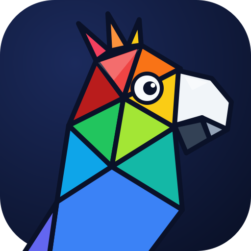

<p align="center"></p>

# Polyglass

**Live on-screen translation for Windows.** Pick any area of the screen. Polyglass keeps reading it and
paints the translation right over the original text, matching its background, colour, size and weight.
It works on anything you can see: apps, games, videos with burned-in subtitles, chats, images.

<!-- TODO: demo GIF -->

> Status: early alpha (0.1). Windows 10/11 only.

## How it works

1. Press **Ctrl+Alt+L** and drag over the text you want translated.
2. Polyglass watches that area. Whenever its content changes and settles (scrolling, new subtitles), it
   reads the text with Windows' built-in OCR, groups it into paragraphs and list items, and translates them.
3. Each translation is painted over its original, in matching colours. The overlay ignores the mouse, so
   you keep clicking and scrolling underneath, and it is invisible to screenshots.

| Hotkey | Action |
|---|---|
| **Ctrl+Alt+L** | Pick an area (again to move it) |
| **Ctrl+Alt+K** | Hide/show the overlay to peek at the original |
| **Ctrl+Alt+X** | Stop watching |

### Translating a video's subtitles

1. Start the video. Fullscreen or windowed both work.
2. Press **Ctrl+Alt+L** and drag a box over the strip where the subtitles appear. Make it a bit taller than
   one line so two-line subtitles fit.
3. Each new subtitle is read and its translation painted over it as it appears. Press **Ctrl+Alt+K** to peek
   at the original, and **Ctrl+Alt+X** to stop.

Set the subtitle language under **Settings → Translation → Translate from**, and install its Windows OCR language
(see [Languages](#languages)).

Everything else is in the tray menu and the **Settings** window: translator, languages, API keys, hotkeys,
the corner marks around the watched area, and starting with Windows.

## Translators

| Translator | Needs | Notes |
|---|---|---|
| Claude | an Anthropic API key | Best with context and slang; model and effort configurable |
| DeepL | a DeepL API key | The free plan covers 500,000 characters a month |

Paste your key in **Settings → Keys**. It is stored in Windows Credential Manager, never in Polyglass's own
files. The `ANTHROPIC_API_KEY` and `DEEPL_API_KEY` environment variables work too and take precedence.

Offline translation (downloadable language packs, no key needed) is planned.

## Languages

Text is read by Windows' own OCR, so the languages you can translate *from* are the Windows OCR languages
installed on your PC (Settings → Time & language → Language & region → add a language). Any language the
translator supports works as the target.

## Privacy

The screen area you pick is processed on your PC. Only the recognised text is sent, to the translator you
chose. Polyglass has no telemetry. Details in [docs/PRIVACY.md](docs/PRIVACY.md).

## Install

Download `Polyglass-<version>-setup.exe` from the [releases page](https://github.com/lcubrilo/polyglass/releases)
and run it. It installs for your user only, so no administrator rights are needed. Windows may warn that the
installer is from an unknown publisher because it isn't code-signed yet: choose **More info → Run anyway**.
A portable zip is there too.

Settings live in `%APPDATA%\Polyglass\config.json`, logs in `%LOCALAPPDATA%\Polyglass\logs`.

## Run from source (for developers)

You need Windows 10/11, [Python 3.11+](https://www.python.org/downloads/windows/) (with the `py` launcher,
the installer's default) and [Git](https://git-scm.com/download/win). In PowerShell:

```powershell
git clone https://github.com/lcubrilo/polyglass
cd polyglass
py -3.11 -m venv .venv
.venv\Scripts\pip install -e ".[dev]"
.venv\Scripts\python -m polyglass
```

Clone into a short path such as `C:\src\polyglass`: Qt's deeply nested files can hit Windows' 260-character
path limit during `pip install` in very deep folders.

The last line runs Polyglass with a console, so you see its log output. Close it from the tray icon.

To start it like a normal app, create a **Polyglass (dev)** shortcut on your desktop (add `-StartMenu` to
also put it in the Start Menu):

```powershell
powershell -ExecutionPolicy Bypass -File tools\create_shortcut.ps1
```

The shortcut runs your checkout without a console window, so code changes take effect on the next start.
To update, `git pull` and, if `pyproject.toml` changed, run the `pip install` line again.

Tests, lint and building the installer are covered in [CONTRIBUTING.md](CONTRIBUTING.md).

## Contributing

Bug reports, ideas and pull requests are welcome; see [CONTRIBUTING.md](CONTRIBUTING.md) and the
[architecture overview](docs/ARCHITECTURE.md).

## License

[GNU GPL v3 or later](LICENSE). Polyglass builds on the open-source libraries listed in
[THIRD_PARTY_NOTICES.md](THIRD_PARTY_NOTICES.md).
